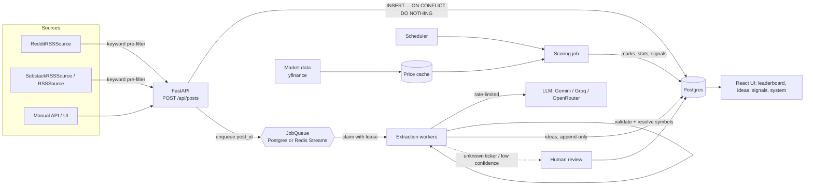

# Architecture

## Components



All of these can run in **one process** (API plus embedded worker and scheduler threads, which suits a free Render instance) or as **separate processes** (`serve`, `worker`, `scheduler`) that scale independently. The code is the same either way; only the `EMBEDDED_*` flags change.

## The life of one post

```mermaid
sequenceDiagram
    participant C as Client
    participant A as API
    participant D as Postgres
    participant Q as Queue
    participant W as Worker
    participant L as LLM
    C->>A: POST /api/posts {text, author} + Idempotency-Key
    A->>D: BEGIN; upsert contributor; INSERT raw_post ON CONFLICT DO NOTHING
    A->>Q: enqueue {post_id}   (same transaction if Postgres queue)
    A->>D: COMMIT
    A-->>C: 202 {post_id, status: pending}
    W->>Q: claim (lease 120s)   [rate-limit token acquired first]
    W->>D: read post (short txn), skip if not pending
    W->>L: extract (no DB transaction held open)
    L-->>W: JSON
    W->>W: pydantic validate → resolve tickers → horizon → confidence gate
    W->>D: BEGIN; SELECT post FOR UPDATE; re-check pending; INSERT ideas ON CONFLICT DO NOTHING; set status; COMMIT
    W->>Q: ack (fenced: only if we still own the lease)
    Note over W,Q: crash anywhere before ack → lease expires → another worker redoes it → idempotent
```

## Scoring (batch, a few times a day)

1. **Advisory lock** (`pg_try_advisory_lock`) so only one scoring run happens at a time across all instances.
2. Load every idea whose mark isn't final (`closed` marks never change).
3. Fetch adjusted daily bars per ticker through the **read-through price cache**, plus the exchange's benchmark.
4. `mark_idea` (a pure function):
   - entry = first open after `effective_at`, in the exchange's timezone
   - exit = close of the horizon's last *completed* session
   - excess = direction × (stock return − benchmark return), then normalised to 20 days by multiplying by √(20/h)
   - missing data → `unscorable` with a reason (never dropped)
5. `estimate_skill` (pure): pooled σ², moment-estimated τ², posterior mean/sd and P(skill > 0) per contributor.
6. Signals: the latest view per contributor per ticker, weighted by max(0, 2·P − 1); portfolio weights scaled to gross 1; historical VaR/CVaR.
7. Everything is written to **derived tables** (`idea_marks`, `contributor_stats`, `signal_snapshots`) that can be deleted and rebuilt from the immutable facts.

## Data model

| Table | Kind | Notes |
|---|---|---|
| `contributors` | fact | unique (source, handle) |
| `raw_posts` | fact | unique `dedupe_key`; `received_at` = our clock; status machine `pending → extracted / no_idea / needs_review → rejected / failed` |
| `trade_ideas` | fact, **append-only** | trigger blocks UPDATE/DELETE; unique (post_id, ticker); `effective_at` drives entry price |
| `idea_marks` | derived | one row per idea, re-marked until closed |
| `contributor_stats` | derived | recomputed every run |
| `signal_snapshots` | derived | history of signal outputs |
| `jobs` | infra | Postgres queue; partial index on live jobs only |
| `prices`, `price_coverage` | cache | adjusted bars, and the date range held per ticker |
| `symbols` | reference | symbol master; grows when an unknown ticker passes a price-history check |
| `llm_cache` | cache | key = sha256(model, prompt version, posted date, text) |
| `worker_heartbeats`, `scoring_runs` | observability | shown on the System page |

## Design patterns used (and why)

- **Adapter + inheritance**: every source produces the same `PostIn`, so ingestion never knows where a post came from. `Source` (abstract) → `RSSSource` → `RedditRSSSource` / `SubstackRSSSource` (each *is* an RSS feed with a known URL pattern, so they inherit the parsing); `StockTwitsAPISource` and `RedditAPISource` implement `Source` directly because they speak JSON. A registry in `sources/factory.py` maps a `(kind, target)` choice to a class.
- **Strategy**: `IdeaExtractor` has `LLMIdeaExtractor` and `RuleBasedExtractor`; `MarketDataProvider` has `YFinanceProvider` and `SyntheticProvider`; `JobQueue` has `PostgresQueue` and `RedisStreamQueue`. Each is swappable by config and in tests.
- **Repository / read-through cache**: `PriceStore` hides whether bars come from Postgres or the provider.
- **Composition root / dependency injection**: `runtime.py` is the only place concrete classes are wired together.
- **Functional core, imperative shell**: marking, skill and signals are pure functions (heavily unit-tested); the scoring job only does I/O around them.
